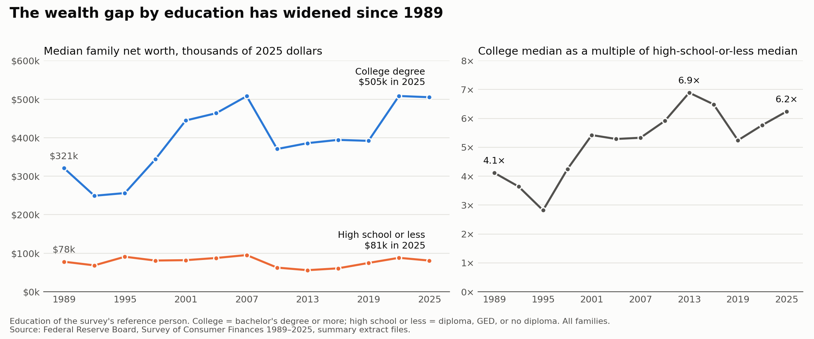

# Wealth gap by education, 1989–2025

How the net worth gap between families with a college-educated head and families with a
high school education or less has changed in the US since 1989.



## The figure

[`figures/networth_gap_by_education.png`](figures/networth_gap_by_education.png) has two panels:

- **Left:** median family net worth, in thousands of 2025 dollars, for families whose
  reference person has a college degree (bachelor's or more) and for those with a high
  school education or less (diploma, GED, or no diploma).
- **Right:** the college median as a multiple of the high-school-or-less median. It rose
  from 4.1× in 1989 to 6.2× in 2025.

Definitions: education is that of the survey's "reference person" (one person per family,
not both parents), and "families" includes households without children. There are no
error bars yet.

## Data

Federal Reserve Board, [Survey of Consumer Finances](https://www.federalreserve.gov/econres/scfindex.htm)
(SCF), all 13 surveys from 1989 to 2025.

- **Summary extract files** (`scfp{YEAR}excel.zip`), one per survey. These supply
  `NETWORTH`, `EDCL` (education of the reference person) and `WGT` (the survey weight).
  The Fed has already converted them to 2025 dollars.
- **Historic tables** (`scf2025_tables_public_real_historical.xlsx`). This file is used
  only as a check: `get_data.py` confirms that its estimates for the four education
  groups match Table 4 exactly.

The combined "high school or less" group isn't published by the Fed. `get_data.py`
computes it from the summary extract files.

## Rerunning

Requires Python 3.

```bash
pip install -r requirements.txt
python3 get_data.py
python3 plot.py
```

- `get_data.py` downloads the raw files into `data/raw/` (about 30 MB, not tracked by
  git) and writes [`data/networth_by_education.csv`](data/networth_by_education.csv):
  weighted median and mean net worth, share of families, and sample size by year and
  education group. If any estimate disagrees with the Fed's Table 4, it stops with an
  error.
- `plot.py` reads that CSV and draws the figure.
